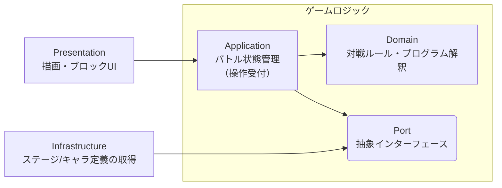

# ソフトウェアアーキテクチャ

コンセプトは **ドメイン中心の4層クリーンアーキテクチャ**。  
変わりにくいもの（ゲームロジック）を中心に、変わりやすいもの（UI・外部データ）を外側へ配置する。  
これによりゲームロジックを UI・外部データから完全に分離し、変更に強くテストしやすい構成にする。

---

## 全体像

| 層                               | 責務                                                   | 変わりやすさ         |
| -------------------------------- | ------------------------------------------------------ | -------------------- |
| **Domain**（ドメイン層）         | 対戦のルールと**プログラムの解釈実行**（純TS・決定的） | 変わりにくい（中心） |
| **Application**（アプリ層）      | バトル進行・ゲーム状態の更新（今どうなっているか）     | 中間                 |
| **Infrastructure**（インフラ層） | ステージ/キャラ定義の読み込み、（将来）生JS実行Worker  | 変わりやすい         |
| **Presentation**（プレゼン層）   | バトルポッドの描画、ブロックUI、操作の受付             | 変わりやすい（外縁） |

```
skeleton-app/src/lib/
├── domain/          # ドメイン層
├── application/     # アプリ層
├── infrastructure/  # インフラ層
└── presentation/    # プレゼン層
```

### ドメイン層とアプリ層の境界

**静的なルールか、動的な状態か**で分ける。

- **静的なルール（ドメイン層）**: 対戦の状況に依存せず定義できるルール・アクションの効果・プログラムの解釈規則
- **動的な状態（アプリ層）**: その対戦その瞬間の可変情報（現在の盤面・進行・結果）

判定基準は「バトル開始前に確定しているか」。Yes ならドメイン層、No ならアプリ層。

---

## 依存の向きとアクセスパターン

**依存は外側→内側の一方向のみ。内側は外側を参照しない。**



外側から内側へのアクセスは次の経路に限定する。

| 境界           | アクセスパターン             | 効果                                                                       |
| -------------- | ---------------------------- | -------------------------------------------------------------------------- |
| インフラ層から | **Port + Adapter**           | 取得は Port 経由のみ。供給元（ファイル/将来のAPI）をゲームロジックから隠蔽 |
| プレゼン層から | **Facade**（`BattleFacade`） | UI の操作を単一窓口に集約。ゲームロジックの内部構造を UI から隠蔽          |

---

## データフロー

1 バトルの流れで各層の分担を示す。

1. **インフラ層** がステージ/キャラ定義を読み込み、`Port` の契約形で返す
2. **プレゼン層** がブロックUIで組まれたプログラム（命令木）を受け取る
3. **プレゼン層** が **アプリ層** の `BattleFacade` を呼ぶ
4. **アプリ層** が **ドメイン層** のバトルエンジンを呼ぶ
5. **ドメイン層** が共通クロックでプログラムを解釈実行し、新しい `BattleState` を返す（[execution-model.md](./execution-model.md)）
6. **アプリ層** がその `BattleState` でストアを上書きする
7. **プレゼン層** がストアの変更を検知して再描画・観戦する

ゲームロジックへの入口は `BattleFacade` のみ、出力は新しい `BattleState` のみ。

---

## 各層の構造（初期案）

```
domain/
├── models/        # BattleState, Automaton, Program, Action, Sensor 等（readonly）
├── interpreter/   # 再開可能インタプリタ（命令木 → アクション列）
└── battle/        # 共通クロックのバトルループ・勝敗判定

application/
├── BattleFacade.ts
├── stores/        # バトル状態（ストア機構は実装時確定）
├── ports/         # IStageRepository 等
└── usecases/      # モード別（チュートリアル / 対戦）

infrastructure/
└── adapters/      # ステージ/キャラ定義ローダ、（将来）生JS Worker

presentation/
├── components/    # 対戦空間描画・ブロックエディタ（Blockly は use: で統合）
└── stores/        # UI 状態のみ
```

> ドメイン層は Pure TypeScript で書き、Svelte / DOM / 外部データを持ち込まない（ロジック単体でテスト可能）。
