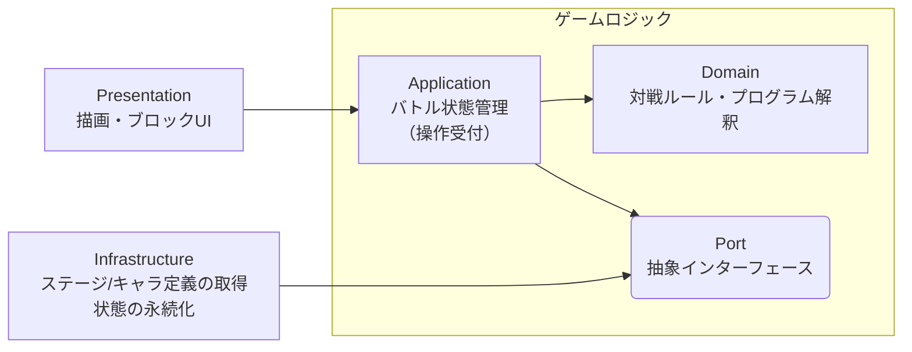

# ソフトウェアアーキテクチャ

コンセプトは **ドメイン中心の4層クリーンアーキテクチャ**。  
変わりにくいもの（ゲームロジック）を中心に、変わりやすいもの（UI・外部データ）を外側へ配置する。  
これによりゲームロジックを UI・外部データから完全に分離し、変更に強くテストしやすい構成にする。

---

## 全体像

| 層                               | 責務                                                   | 変わりやすさ         |
| -------------------------------- | ------------------------------------------------------ | -------------------- |
| **Domain**（ドメイン層）         | 対戦のルールと**プログラムの解釈実行**（純TS・決定的） | 変わりにくい（中心） |
| **Application**（アプリ層）      | バトル進行・ゲーム状態の更新（今どうなっているか）     | 中間                 |
| **Infrastructure**（インフラ層） | ステージ/キャラ定義の読み込み・状態の永続化            | 変わりやすい         |
| **Presentation**（プレゼン層）   | バトルポッドの描画、ブロックUI、操作の受付             | 変わりやすい（外縁） |

```
skeleton-app/src/lib/
├── domain/          # ドメイン層
├── application/     # アプリ層
├── infrastructure/  # インフラ層
└── presentation/    # プレゼン層
```

### ドメイン層とアプリ層の境界

**静的なルールか、動的な状態か**で分ける。

- **静的なルール（ドメイン層）**: 対戦の状況に依存せず定義できるルール・アクションの効果・プログラムの解釈規則
- **動的な状態（アプリ層）**: その対戦その瞬間の可変情報（現在の盤面・進行・結果）

判定基準は「バトル開始前に確定しているか」。Yes ならドメイン層、No ならアプリ層。

---

## 依存の向きとアクセスパターン

**依存は外側→内側の一方向のみ。内側は外側を参照しない。**



外側から内側へのアクセスは次の経路に限定する。

| 境界           | アクセスパターン       | 効果                                                                        |
| -------------- | ---------------------- | --------------------------------------------------------------------------- |
| インフラ層から | **Port + Adapter**     | 取得・永続化は Port 経由のみ。供給元・保存先をゲームロジックから隠蔽        |
| プレゼン層から | **Facade**（機能ごと） | 機能/画面ごとに操作を単一窓口へ集約。ゲームロジックの内部構造を UI から隠蔽 |

- 状態を持つ機能では、書き込み（操作）は Facade に集約する。読み取り（参照）は、状態の読み取り専用な投影を購読する（Facade を介さなくてもよい）。
- 状態を持たない機能の Facade はステートレスに保ち、戻り値で状態を返す。
- **プレゼン層はアプリ層バレル（`$lib/application`）のみを窓口とする**。ドメイン層（`$lib/domain`）・インフラ層（`$lib/infrastructure`）を直接 import しない。プレゼンが要るドメイン型/定数はアプリ層バレルが re-export で供給する（型は素通し＝将来 View Model へ差し替え可能。業務操作は re-export せず Facade/投影に閉じる）。唯一の例外は合成ルート（`presentation/composition.ts`）がインフラ層の具体 Adapter を取る時のみ。
- 各層の依存ルール（ROLE / ALLOWED / FORBIDDEN）は各層バレルの冒頭 `@architecture` コメントに宣言し、プレゼン層からのドメイン/インフラ直 import は lint（`no-restricted-imports`）で機械的に禁止する。

---

## データフロー

1 バトルの流れで各層の分担を示す。

1. **インフラ層** がステージ/キャラ定義を読み込み、`Port` の契約形で返す
2. **プレゼン層** がブロックUIで組まれたプログラム（命令木）を受け取る
3. **プレゼン層** が **アプリ層** の `BattleFacade` を呼ぶ
4. **アプリ層** が **ドメイン層** のバトルエンジンを呼ぶ
5. **ドメイン層** が共通クロックでプログラムを解釈実行し、新しい `BattleState` を返す（[execution-model.md](./execution-model.md)）
6. **アプリ層** が観戦用のフレーム列（`BattleState` の列）と結果を返す
7. **プレゼン層** がそれを `$derived` で受け、盤面・プログラムを再描画・観戦する

ゲームロジックへの入口は `BattleFacade` のみ、出力は新しい `BattleState` のみ。

---

## 各層の構造

```
domain/
├── models/       # 各種モデル・インターフェース
├── battle/       # 共通クロックのバトルループ・勝敗判定・パラメータ
├── program/      # 命令木の純解析（CP コスト・ノード採番/平坦化）
├── interpreter/  # 再開可能インタプリタ（命令木 → Step 列）
└── index.ts      # ドメイン層の公開 API

application/
├── usecases/     # 機能スライス。各機能が自分の facade（単一窓口）を持ち、関連する状態も同居させる
├── ports/        # 機能ごとの Port 抽象（取得・永続化の契約）
└── index.ts      # アプリ層の公開 API

infrastructure/
├── stages/       # ステージ定義データ（TS 定数版の供給元）
├── adapters/     # Port 実装（定義の供給元・状態の保存先。将来 JSON/DSL/API/別ストレージ）
└── index.ts      # インフラ層の公開 API

presentation/
├── components/    # UI 所掌ごとに分割（[ui-screen-design.md](./ui-screen-design.md)）
├── blockly/       # Program ⇄ Workspace 変換（Blockly 統合）
├── constants/     # 画面定数（ルート名・プリセット等）
├── utils/         # 共通ユーティリティ
└── composition.ts # 合成ルート（具体 Adapter → Facade の DI 配線。module singleton）
```
